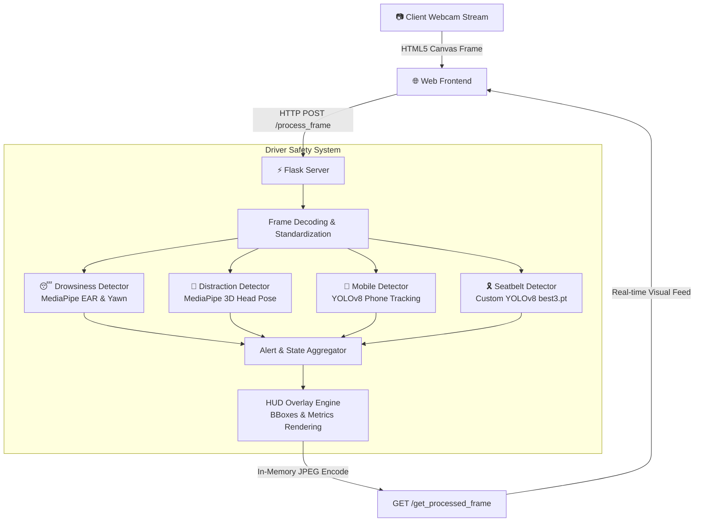

# 🚗 AI Driver Safety & Monitoring System

[](https://www.python.org/)
[](https://pytorch.org/)
[](https://github.com/ultralytics/ultralytics)
[](https://opencv.org/)
[](https://developers.google.com/mediapipe)
[](https://flask.palletsprojects.com/)

An intelligent, real-time computer vision system engineered to prevent road accidents by proactively detecting driver fatigue, distraction, seatbelt violations, and illegal mobile phone usage. 

All processing runs **100% live in-memory** with hardware GPU acceleration and renders interactive visual HUD alerts directly onto the live browser feed with zero disk I/O overhead.

---

## 📌 Table of Contents
- [System Architecture](#-system-architecture)
- [Key Detection Modules](#-key-detection-modules)
- [Tech Stack](#-tech-stack)
- [Project Structure](#-project-structure)
- [Getting Started](#-getting-started)
  - [Prerequisites](#prerequisites)
  - [Installation & Setup](#installation--setup)
  - [Running the Application](#running-the-application)
- [Configuration & Thresholds](#-configuration--thresholds)
- [Performance & Hardware](#-performance--hardware)
- [License & Acknowledgments](#-license--acknowledgments)

---

## 🧠 System Architecture



---

## 🌟 Key Detection Modules

### 1. 😴 Drowsiness & Fatigue Detection ([`drowsiness_detection.py`](file:///d:/ABDULLAH%20UNI/Semester%206/DIP/CV_Proj/car_cam/drowsiness_detection.py))
- **Eye Aspect Ratio (EAR)**: Monitors eye openness using 468 MediaPipe facial landmark coordinates.
- **Blink Frequency**: Calculates live blinks per minute to track gradual fatigue trends.
- **Yawn Detection**: Monitors mouth aperture distance over time to flag prolonged yawning episodes.

### 2. 👀 Distraction & Head Pose Estimation ([`distraction_detection.py`](file:///d:/ABDULLAH%20UNI/Semester%206/DIP/CV_Proj/car_cam/distraction_detection.py))
- **3D Pose Reconstruction**: Maps 2D landmark coordinates to canonical 3D facial points via OpenCV `solvePnP`.
- **Yaw & Pitch Tracking**: Calculates rotational angles to detect when the driver turns away from the forward roadway (left, right, up, or looking down).
- **Time Thresholding**: Filters out momentary mirror checks while triggering alerts if attention lapses exceed 2.0 seconds.

### 3. 📱 Mobile Phone Detection ([`mobile_detection.py`](file:///d:/ABDULLAH%20UNI/Semester%206/DIP/CV_Proj/car_cam/mobile_detection.py))
- **YOLOv8 Inference**: Detects handheld mobile devices in real time with high confidence scoring.
- **Intersection over Union (IoU) Tracking**: Sustains tracking across frames to prevent flickering and maintain persistent bounding boxes.
- **Temporal Alerting**: Triggers alerts only when phone usage persists beyond configurable safety limits.

### 4. 🎗️ Seatbelt Compliance Detection ([`seatbelt_detection.py`](file:///d:/ABDULLAH%20UNI/Semester%206/DIP/CV_Proj/car_cam/seatbelt_detection.py))
- **Custom Fine-Tuned YOLOv8**: Uses a dedicated trained weights file (`best3.pt`) to identify seatbelt presence over the driver's torso.
- **Frame-Skip Optimization**: Skips inference across redundant frames for optimized FPS while retaining responsive alerts.

---

## 🛠️ Tech Stack

| Domain | Technology | Purpose |
|---|---|---|
| **Language** | Python 3.11 / 3.12 | Core application runtime |
| **Deep Learning** | PyTorch + CUDA | Hardware-accelerated neural network execution |
| **Object Detection** | Ultralytics YOLOv8 | Mobile phone and seatbelt identification |
| **Facial Landmark Mesh** | Google MediaPipe | High-speed 468-point facial mesh tracking |
| **Computer Vision** | OpenCV (`cv2`) | Image manipulation, pose estimation, and UI drawing |
| **Web Framework** | Flask | Lightweight streaming and API routing |
| **Frontend** | HTML5 / JavaScript | WebRTC webcam capture and responsive HUD interface |

---

## 📂 Project Structure

```text
car_cam/
├── app.py                      # Flask application and REST/streaming endpoints
├── driver_safety_system.py      # Main pipeline orchestrating all detectors & alerts
├── distraction_detection.py    # MediaPipe head pose & yaw/pitch distraction logic
├── drowsiness_detection.py      # Eye Aspect Ratio (EAR), blink counter & yawn detector
├── mobile_detection.py         # YOLOv8 mobile device detector with IoU tracking
├── seatbelt_detection.py       # Custom YOLOv8 seatbelt compliance classifier
├── best3.pt                    # Custom trained YOLO weights for seatbelt detection
├── yolov8n.pt                  # Pretrained YOLOv8 Nano base model
├── templates/
│   └── index.html              # Responsive web dashboard with live HUD feed
├── requirements.txt            # Python dependencies
└── .gitignore                  # Git ignore rules for venv, cache, and logs
```

---

## 🚀 Getting Started

### Prerequisites
- **Operating System**: Windows 10/11, Linux, or macOS
- **Python**: Version `3.11.x` (Recommended) or `3.12.x`
- **Webcam**: Built-in or external USB camera
- **GPU (Optional but Recommended)**: NVIDIA GPU with CUDA support for real-time 30+ FPS performance

### Installation & Setup

1. **Clone the repository**:
   ```powershell
   git clone https://github.com/<your-username>/<your-repo-name>.git
   cd car_cam
   ```

2. **Create and activate a virtual environment**:
   ```powershell
   python -m venv .venv
   .\.venv\Scripts\Activate.ps1
   ```

3. **Install PyTorch with CUDA support** *(for NVIDIA GPUs)*:
   ```powershell
   pip install torch torchvision torchaudio --index-url https://download.pytorch.org/whl/cu118
   ```

4. **Install computer vision & project dependencies**:
   ```powershell
   pip install ultralytics "mediapipe==0.10.21" opencv-python flask sounddevice
   ```

### Running the Application

1. **Start the Flask server**:
   ```powershell
   python .\app.py
   ```

2. **Access the live dashboard**:
   Open Google Chrome or any modern browser and navigate to:
   ```text
   http://127.0.0.1:5000
   ```

3. **Click "Start"**: Grant camera permissions when prompted. The processed feed with real-time detection bounding boxes and driver safety metrics will stream live on screen.

---

## ⚙️ Configuration & Thresholds

Key sensitivity thresholds can be fine-tuned directly in [`driver_safety_system.py`](file:///d:/ABDULLAH%20UNI/Semester%206/DIP/CV_Proj/car_cam/driver_safety_system.py):

| Parameter | Default | Location | Description |
|---|---|---|---|
| `ear_threshold` | `0.25` | `DrowsinessDetector` | Eye aspect ratio below which eyes are marked closed |
| `yawn_threshold` | `25` | `DrowsinessDetector` | Pixel distance threshold indicating an open mouth |
| `per_minute_blink_threshold` | `30` | `DrowsinessDetector` | High blink rate threshold indicative of fatigue |
| `yaw_left` / `yaw_right` | `-40° / +35°` | `DistractionDetector` | Head rotation thresholds for looking away |
| `pitch_up` / `pitch_down` | `+25° / -20°` | `DistractionDetector` | Vertical head angle thresholds |
| `confidence_threshold` | `0.20` | `MobileDetector` | Minimum YOLO confidence to track phone |
| `conf_threshold` | `0.30` | `SeatbeltDetector` | Minimum detection confidence for seatbelt |

---

## ⚡ Performance & Hardware

- **Live In-Memory Processing**: Zero disk writes during live execution; captured frames are processed directly in RAM for low latency.
- **Hardware Acceleration**: Built with PyTorch CUDA runtime, leveraging tensor cores on NVIDIA GPUs (e.g., GeForce GTX 1650 and above) for multi-model inference in parallel.
- **Bandwidth Efficient**: Compressed JPEG encoding ensures fast client-server response times even over local Wi-Fi networks.

---

## 📄 License
This project is developed for academic and research purposes under the Digital Image Processing & Computer Vision curriculum.
